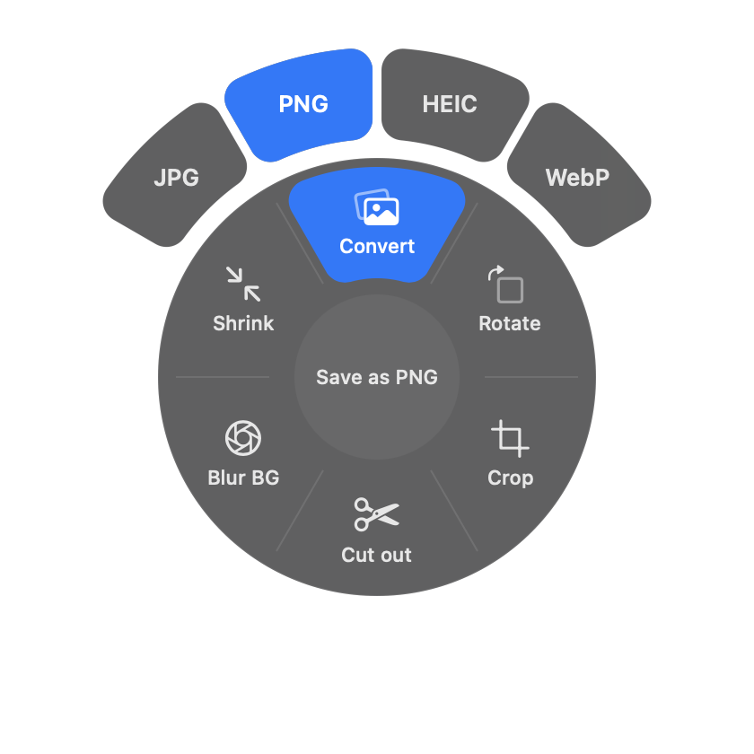
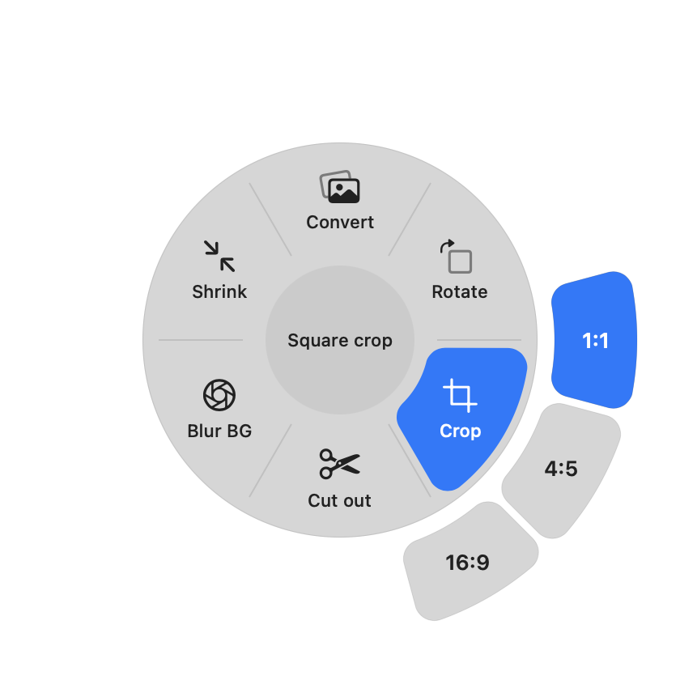

# DropWheel

A tiny macOS menu bar app for converting files in a flick. **Hold Shift while dragging
files** and a wheel appears under your cursor. Drop onto a slice and the result is saved
next to the original. Everything runs on your Mac: no internet, no uploads.

<p align="center">
  
  
</p>

## What it can do

The wheel only shows slices that fit what you're dragging:

| You drag | Slices |
|---|---|
| **Image** | **Convert** → JPG · PNG · HEIC · WebP<br>**Rotate**: 90° clockwise, in place (lossless for JPEG/HEIC)<br>**Crop** → 1:1 · 4:5 · 16:9, centred on the subject<br>**Cut out**: transparent PNG of just the subject<br>**Blur BG**: portrait-mode style blurred background<br>**Shrink**: max 2560px, JPEG 60% |
| **Word / RTF / OpenDocument** | **PDF** (no app opens, no windows) |
| **PDF** | **Split** into one file per page · **Shrink** |
| **Video** | **MP4** · **MP3** (audio only) · **Shrink** to 720p |
| **Audio** | **MP3** |

## Install

Requirements: macOS 14 (Sonoma) or newer and [Homebrew](https://brew.sh).

**1. Install Apple's developer tools** (skip if you've done this before):

```bash
xcode-select --install
```

**2. Install the optional helpers.** `ffmpeg` enables WebP and MP3. LibreOffice keeps
pictures when turning Word files into PDFs. DropWheel works without them; those
features are just disabled or simpler.

```bash
brew install ffmpeg
```

```bash
brew install --cask libreoffice
```

**3. Download and install DropWheel:**

```bash
git clone https://github.com/Beqarev/DropWheel.git ~/DropWheel
```

```bash
~/DropWheel/build.sh install
```

This builds the app, puts it in `/Applications`, and starts it. A ◎ icon appears in
your menu bar.

**4. Allow folder access.** On first start, macOS asks whether DropWheel may access your
Desktop, Documents and Downloads folders. Click **Allow** each time, so it can save
converted files next to the originals.

**5. Start it automatically** (optional): click the ◎ icon → **Launch at Login**.

## How to use

1. Start dragging one or more files in Finder (or from your Desktop).
2. While dragging, hold **Shift**. The wheel appears under your cursor.
3. Move onto a slice and let go.
   - **Convert** and **Crop** open an outer ring: move onto the slice, then outward onto the choice (e.g. PNG).
   - Let go in the **centre** to cancel.
4. A green checkmark means it's done. The new file sits next to the original
   (`photo.png`, `photo 1x1.jpg`, `photo cutout.png`, …).

Only **Rotate** changes the original file. Everything else makes a new one and never
overwrites anything.

## Update

After pulling new code (or changing it yourself), reinstall:

```bash
cd ~/DropWheel && git pull && ./build.sh install
```

macOS may ask for folder access again after each install, because the app is signed
locally rather than with an Apple Developer certificate.

## Uninstall

Click the ◎ icon → **Quit DropWheel**, then delete `/Applications/DropWheel.app`.

---

## For developers

Built with Swift, SwiftUI and AppKit, using only Apple frameworks (ImageIO, AVFoundation,
PDFKit, Vision, Core Image) plus the optional `ffmpeg` and LibreOffice. There's no Xcode
project: `swift build` compiles it, and `build.sh` wraps it into an `.app`.

```bash
./build.sh run                         # build and launch from build/
build/DropWheel.app/Contents/MacOS/DropWheel --convert cutout photo.jpg   # test a conversion
build/DropWheel.app/Contents/MacOS/DropWheel --preview image 0 1          # show the wheel for 6 s
```

| File | Role |
|------|------|
| `main.swift` | Starts the app as a menu bar app (no Dock icon). |
| `AppDelegate.swift` | Menu bar icon and menu; wires the drag monitor to the overlay. |
| `DragMonitor.swift` | Watches system-wide mouse drags. Fires when Shift is held **and** files are being dragged. |
| `Overlay.swift` | The floating frosted-glass window, and `DropView`, which receives the drop and works out which slice is under the cursor. |
| `WheelView.swift` | The wheel drawing (SwiftUI) plus the angle math. |
| `WheelAction.swift` | Every action, which file types it accepts, and how they group into slices. **Add a new slice here.** |
| `Converter.swift` | Format conversions, video/audio, PDF shrink/split. |
| `ImageEdits.swift` | Rotate, smart crop, cut out and blur background (Apple's Vision framework). |
| `DocumentConverter.swift` | Word → PDF (LibreOffice if installed, otherwise macOS's built-in reader, which skips pictures). |
| `DevCommands.swift` | Terminal test helpers. |

**No Accessibility permission needed.** macOS lets any app observe global *mouse* events;
only keyboard monitoring needs permission. DropWheel never watches the keyboard. It
reads whether Shift is down at the moment the mouse drags.

**Zero cost when idle.** No timers or polling: macOS wakes the app only on mouse press
or drag. It idles at 0% CPU and about 35 MB of memory.

### Ideas

- Settings window: modifier key, JPEG quality, max size.
- Progress ring for long video exports.
- "Reveal in Finder" after converting.
- A real crop window with handles.
- PDF → Word (via LibreOffice) and GIF ↔ MP4.
